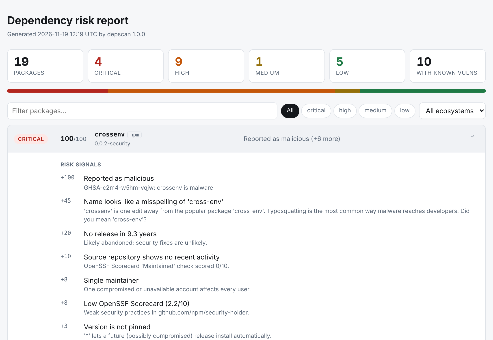

# depscan — Dependency Risk Scanner

[](https://github.com/itsfingerlickinggood/chronos-os/actions/workflows/ci.yml)

**Find the risky open-source packages in your project before attackers do.**

A modern app installs hundreds of third-party packages. Some are abandoned, some
have known vulnerabilities, some are malicious lookalikes of popular packages
(`reqeusts` instead of `requests`), and some do not exist publicly at all, which
lets anyone register the name and get their code installed on your machines.

`depscan` reads your `requirements.txt`, `pyproject.toml` or `package.json`, looks
every package up in free public data sources, and gives each one an explainable
**risk score from 0 to 100**.



- **Free to run.** No paid services, no API keys, no account.
- **Zero runtime dependencies.** A supply-chain tool should not add to your supply chain; it uses only the Python standard library.
- **Explainable.** Every point of a score comes from a named signal with a plain-English reason.
- **Three ways to use it.** Command line, GitHub Action that comments on pull requests, and a standalone HTML dashboard.

## Quick start

Requires Python 3.11 or newer.

```bash
git clone https://github.com/itsfingerlickinggood/chronos-os.git
cd chronos-os
pip install .

depscan examples                 # scan the demo projects in this repo
depscan path/to/your/project     # scan your own project
```

```text
RISK      SCORE  PACKAGE                VERSION         ECO   MAIN REASON
----------------------------------------------------------------------------------
CRITICAL  100    crossenv               0.0.2-security  npm   Reported as malicious
CRITICAL  100    reqeusts               0.0.1           pypi  Package does not exist on the public registry
CRITICAL  89     axios                  0.21.0          npm   25 known vulnerabilities in 0.21.0
HIGH      70     acme-internal-billing  1.4.2           pypi  Package does not exist on the public registry
HIGH      64     lodash                 4.17.15         npm   5 known vulnerabilities in 4.17.15
LOW       0      numpy                  1.26.4          pypi  no risk signals

reqeusts 0.0.1  [critical 100/100]  examples/python-app/requirements.txt
  +70  Package does not exist on the public registry
  +45  Name looks like a misspelling of 'requests'
       'reqeusts' is one edit away from the popular package 'requests'. Did you mean 'requests'?
```

## Usage

```bash
depscan scan [PATHS...]          # files or directories; default is the current directory
depscan check requests==2.19.0   # check one PyPI package
depscan check lodash@4.17.15 -e npm
```

| Option | What it does |
|---|---|
| `--html FILE` | Write the interactive dashboard (one self-contained HTML file) |
| `--json FILE` / `--markdown FILE` | Write machine-readable / pull-request-ready reports |
| `--format table\|json\|markdown` | What to print to the terminal |
| `--fail-on LEVEL` | Exit with status 1 if any package is `low`/`medium`/`high`/`critical` or above (for CI) |
| `--baseline-dir DIR --only-new` | Report only dependencies added or changed compared with an older copy of the files |
| `--no-dev` | Skip development-only dependencies |
| `--no-cache` | Ignore the 24-hour on-disk cache in `~/.cache/depscan` |

Exit codes: `0` success, `1` a package reached the `--fail-on` level, `2` bad input.

## Use it as a GitHub Action

Add `.github/workflows/depscan.yml` to any repository. On every pull request it
reviews **only the dependencies that pull request adds or changes** and posts the
result as a comment.

```yaml
name: Dependency review
on: pull_request

permissions:
  contents: read
  pull-requests: write

jobs:
  depscan:
    runs-on: ubuntu-latest
    steps:
      - uses: actions/checkout@v4
      - uses: itsfingerlickinggood/chronos-os@main
        with:
          fail-on: high        # block the pull request on high or critical risk
```

| Input | Default | Meaning |
|---|---|---|
| `paths` | `.` | Space-separated files or directories to scan |
| `fail-on` | `none` | Fail the job at this risk level or above |
| `only-new` | `true` | On pull requests, report only added or changed dependencies |
| `comment` | `true` | Post and keep updating one pull request comment |
| `output-dir` | `depscan-report` | Receives `report.json`, `report.md` and `index.html` |

### Live dashboard on GitHub Pages

The [`Dashboard`](.github/workflows/dashboard.yml) workflow scans the demo projects
on every push and once a week, and attaches the HTML dashboard to the run as an
artifact. To also publish it as a website, open the repository's
**Settings → Pages** and set **Source** to **GitHub Actions**; the next run deploys it.

## What it checks

Each signal adds its weight to the score, capped at 100.
**0–24 low · 25–49 medium · 50–74 high · 75–100 critical.**

| Signal | Weight | Why it matters |
|---|---:|---|
| `MALWARE` | 100 | The package has a malicious-code advisory |
| `NOT_FOUND` | 70 | The name is not on the public registry: a typo, or a private name open to *dependency confusion* |
| `VULNERABLE` | 5–60 | Known vulnerabilities in the version in use (critical 40, high 30, medium 15, low 5; capped at 60) |
| `TYPOSQUAT` | 45–60 | The name is one edit away from a popular package and is not itself widely used |
| `VERSION_NOT_FOUND` | 30 | The pinned version was never published or has been removed |
| `DEPRECATED` / `YANKED` | 25 | Maintainers withdrew the package or the release |
| `NEW_PACKAGE` | 15–25 | First published less than 90 / 30 days ago |
| `NEW_PUBLISHER` | 20 | npm: the latest release came from an account that never published this package before |
| `DIRECT_URL` | 20 | Installed from a URL or git repository, bypassing the registry |
| `COMBOSQUAT` | 15–30 | A popular name plus a generic prefix/suffix (`python-requests`, `lodash-js`) |
| `STALE` | 10–20 | No release for more than 2 / 4 years |
| `LOW_DOWNLOADS` | 8–15 | Fewer than 1,000 / 100 downloads a week |
| `INSTALL_SCRIPT` | 12 | npm: runs code at install time |
| `UNMAINTAINED_REPO` | 10 | OpenSSF Scorecard "Maintained" check is 0/10 |
| `SINGLE_MAINTAINER`, `NO_REPO`, `LOW_SCORECARD` | 8 | One account controls the package; no public source; weak repository security practices |
| `SINGLE_RELEASE` | 5 | Only one version was ever published |
| `UNPINNED` | 3 | A version range lets future releases install automatically |

Weak heuristics (`NEW_PUBLISHER`, `INSTALL_SCRIPT`, `SINGLE_MAINTAINER`, `STALE`,
`NO_REPO`, `SINGLE_RELEASE`, `LOW_SCORECARD`) are halved for packages with more
than a million weekly downloads, where they are common and usually benign.

## Data sources

All free and keyless.

| Source | Used for |
|---|---|
| [PyPI JSON API](https://docs.pypi.org/api/json/) and [npm registry](https://registry.npmjs.org) | Existence, versions, release dates, maintainers, install scripts, deprecation |
| [OSV.dev](https://osv.dev) | Known vulnerabilities and malicious-package advisories |
| [npm downloads API](https://github.com/npm/registry/blob/main/docs/download-counts.md), [pypistats](https://pypistats.org/api/) | Weekly download counts |
| [deps.dev](https://deps.dev) | OpenSSF Scorecard for the source repository |
| Bundled lists in [`depscan/data`](depscan/data) | The most-downloaded PyPI and npm names, used as typosquat targets |

## How it works

```text
 manifest files        parsers.py         registries.py + osv.py        scoring.py         report.py
requirements.txt ─┐                      ┌─ PyPI / npm registry ─┐
pyproject.toml   ─┼─►  Dependency  ─────►├─ OSV.dev              ├─►  PackageInfo ─►  Signals + score ─► table / JSON /
package.json     ─┘    (name, version)   ├─ download statistics  │                   (typosquat.py)      Markdown / HTML
                                         └─ deps.dev Scorecard ──┘
```

Lookups run in parallel and are cached on disk for 24 hours. A data source that is
down never fails the scan: the package is reported with whatever could be learned
and marked as incomplete.

## Limitations

- It scans the dependencies you declare, not the transitive ones they pull in. Lockfile support is the natural next step.
- For an npm range such as `^4.17.1` it evaluates the lowest version the range allows.
- PyPI does not publish download counts or maintainer lists through its API. Download counts come from pypistats, which is rate limited, so they are sometimes unknown.
- Scores are heuristics. A high score means "look closer", not "this is malware"; a low score is not a guarantee of safety.

## Development

```bash
pip install -e ".[dev]"
pytest
```

The test suite (77 tests) runs fully offline against an in-memory fake of the network.
See [`docs/PROJECT_REPORT.md`](docs/PROJECT_REPORT.md) for the full project report, and
[`presentation/`](presentation) for the slides and presentation guide.

## License

MIT
